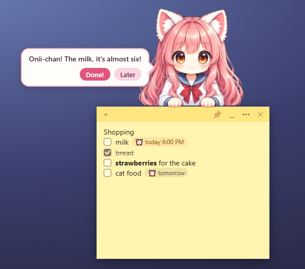
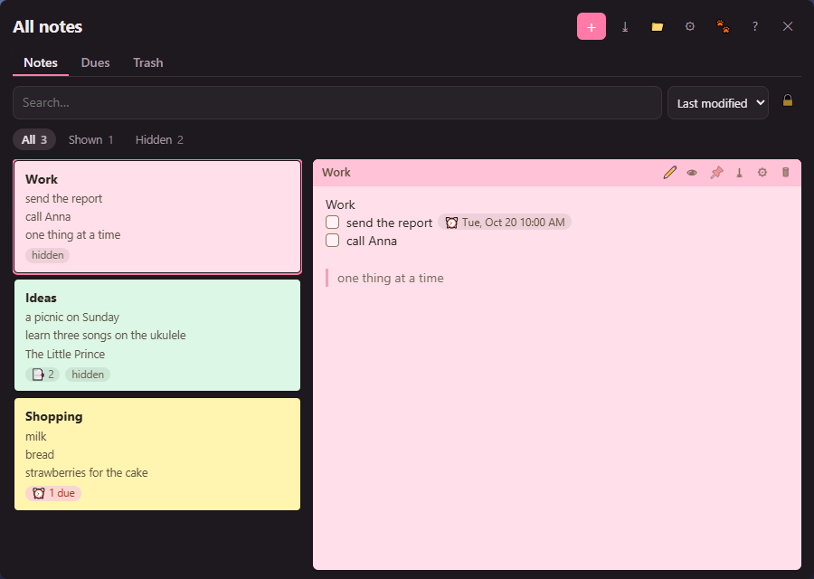

<h1 align="center">Imouto Notes</h1>

<p align="center">Sticky notes for Windows with a chibi neko imouto hanging on them, who reminds you of what is due — and nags, a little more each minute, until you tick it.</p>

<p align="center">
  <a href="https://github.com/martindavinci/ImoutoNotes/releases/latest"></a>
  
  <a href="LICENSE"></a>
</p>

<p align="center">
  
</p>

She is one illustration brought to life in WebGL: she breathes, blinks, sways her hair, turns her head and moves her
mouth while she talks. She sits on the top edge of one of your notes and speaks in a bubble beside her.

## Download

Get `ImoutoNotes_<version>_x64-setup.exe` from the [latest release](https://github.com/martindavinci/ImoutoNotes/releases/latest)
and run it. It installs for your Windows user only, without asking for administrator rights. Each release's notes give
the installer's SHA-256, to check the file you got is the one published here.

- Windows 10 or 11, 64-bit, with the WebView2 runtime (part of Windows 11 and of an updated Windows 10; the installer
  downloads it if it is missing).
- The installer is not signed, so Windows SmartScreen may say "Windows protected your PC": choose **More info**, then
  **Run anyway**.
- The app runs once: starting it again shows the notes. It lives in the notification area, by the clock.

## What it does

- **Notes** that float on the desktop: drag one by its strip, click the strip to roll it up, resize it from the corner.
  Six paper colours or any colour you pick (hue, saturation, lightness or a hex code).
- **Written as Obsidian's live preview shows Markdown**: every line drawn (checkboxes, bullets, due chips, bold and the
  rest without their marks), the source showing only where the cursor is. From the toolbar or the keyboard: bold,
  italic, underline, strikethrough, bulleted and numbered lists, checkboxes, and a due date and time on a checkbox (⏰);
  headings, quotes, a divider, code, code blocks, links and tables.
- **Reminders**: a heads-up ten minutes before a task is due, then a nudge when it is due, then more often and more
  annoyed if you leave it. **Done!** ticks it in its note; **Later** gives you ten minutes.
- **Her voice**: a babble, one blip per letter, or her lines read aloud by one of Windows' own voices (the ones the
  screen reader uses, offline), with her own pitch and speed.
- **Pages** as tabs in a note; **pictures, files and sound clips** dropped or pasted into it; a note's own title, font,
  size, background and lock; a highlighter, text colours and coloured code; smart paste of web pages and code.
- **All notes** in one window: the note picked shown beside the list, search, sorting and filters, every due in one
  list, the trash, export as text, Markdown or JSON.
- **Her look**: a costume for the season (on Halloween, from 25 October to 1 November, a witch hat and a greeting of
  its own) and items she wears over it, automatic, normal or one look all year. Her settings (what she calls you, her
  look, voice and volume, where she sits, Tamburello: she plays along with your keyboard and mouse) have a window of
  their own.
- **Out of your way**: she and the notes never take the keyboard focus when they appear, clicks pass through wherever she
  is not drawn, near the top of the screen the note moves down for her (or she sits at its side, or inside it), and
  neither she nor the notes crowd Alt+Tab or the taskbar.
- **Private**: notes and she can be hidden from screenshots and screen sharing, they can step aside while a game or a
  full-screen app is in front, and the app opens no network connection at all.
- **Light**: about 3 % of one CPU core while she is on screen, near zero while minimized; she stops drawing whenever
  nobody can see her (hidden, screen locked, display off).
- Windows notifications for dues she cannot say, a backup of the notes each day, global shortcuts and a quick capture
  of the clipboard (off until turned on), start with Windows.
- **14 languages**: English, Italiano, Español, Français, Deutsch, Português, Polski, Русский, العربية, हिन्दी,
  Bahasa Indonesia, 日本語, 한국어, 中文.

<p align="center">
  
</p>

## Your notes are Markdown files

One `.md` file per note, in `Documents\Imouto Notes` (or a folder you choose, for example one synced to the cloud or an
Obsidian vault). Any editor can read and change them; the app picks up outside changes as they happen.

```markdown
---
id: k3v9q2m8x1ab
color: yellow
created: 2026-10-19T09:12:00+02:00
---
Shopping
- [ ] milk 📅 2026-10-19 ⏰ 18:00
- [x] bread
```

- A task's due date is written `📅 YYYY-MM-DD` (as the Obsidian Tasks plugin writes it), its time `⏰ H:MM`; a date
  without a time is due at the hour set in the settings (9:00 by default).
- What the app does not understand stays in the file byte for byte.
- A note written elsewhere while you type in it is never lost: the other version is kept beside it as a
  `.conflict-<date>.md` copy. A deleted note goes to the folder's `.trash`.
- Window places, sizes and per-device settings live in the app's config folder
  (`%APPDATA%\io.github.martindavinci.imoutonotes`), never in the notes.

## Encrypted notes

A note can be encrypted from its menu (••• › **Encrypt this note**): it becomes `nota-xxxx.md.bin`, a 🔒 shows on its
strip and in All notes, and it opens only with your password. The other notes stay plain Markdown.

- Turn encryption on in the settings (**Encryption**): the app suggests seven random words as the password; write it
  down. The folder gets a key file, `.imouto-key`, that only the password opens, so any device with the folder (synced
  by Google Drive, Dropbox, Syncthing, or copied by hand) and the password opens the notes. This PC can remember the key
  (**Remember on this PC**); then it never asks again.
- Lose the password and every device that remembered the key, and the encrypted notes are lost: there is no other way
  in.
- Nothing of an encrypted note is written to the disk in clear: its temp files, backups, conflict copies and trash copy
  are encrypted too. Encrypting a note deletes its plain file (not to the trash); old plain copies elsewhere (a cloud
  drive's trash and versions, copies made by hand) are yours to delete.
- Encrypted notes are always hidden from screenshots. Obsidian does not read them.

## Uninstall

Windows Settings › Apps › Imouto Notes › Uninstall. Your notes stay in their folder.

## Feedback

Bugs and ideas are welcome as [issues](https://github.com/martindavinci/ImoutoNotes/issues). The source code is
private; this repository holds the releases.

What changed in each version: [CHANGELOG.md](CHANGELOG.md) (also in the app, under Help).

## Credits

- The figure runs on the runtime of [Mesh Avatar Studio](https://github.com/shinshin86/mesh-avatar-studio) (MIT).
- The note editor is [CodeMirror 6](https://codemirror.net) (MIT), with [@lezer/markdown](https://github.com/lezer-parser/markdown).
- Built with [Tauri](https://tauri.app).
- Every third-party license is listed in the app, under Help › About.

## License

Imouto Notes is freeware: free to use, at home or at work, on as many computers as you like. It may not be
redistributed, sold, modified or decompiled, and the imouto character stays her author's. Download it only from this
repository. The full terms are in [LICENSE](LICENSE); the open-source components inside the app keep their own
licenses.

Made by Martin DaVinci.
